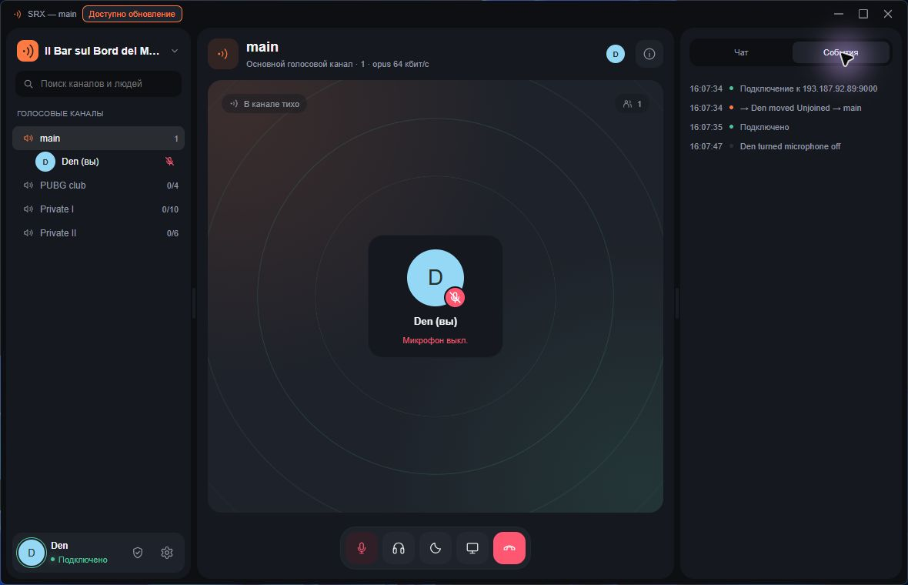
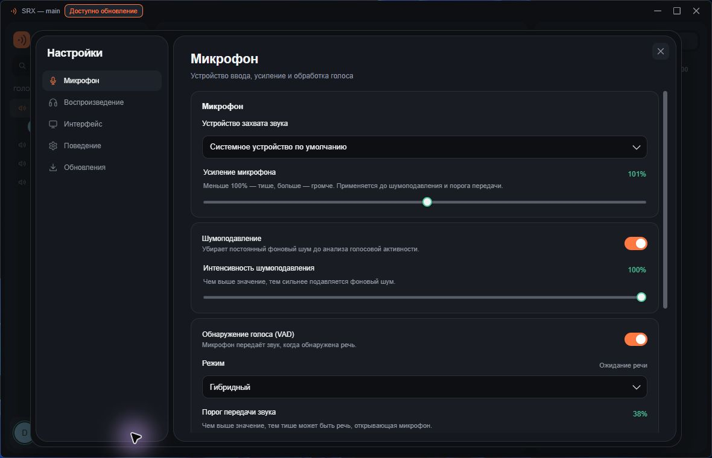

# Sonoryx

Sonoryx — приложение с голосовыми каналами, перепиской, обменом
файлами и демонстрацией экрана. Сервер можно запустить самостоятельно,
создавать на нём каналы и настраивать права участников.

Голос передаётся по защищённому UDP с кодеком Opus. Есть шумоподавление,
активация микрофона по голосу, отдельная громкость участников и глобальные
горячие клавиши.

В каналах и личных диалогах сохраняется история сообщений. Можно писать
пользователям не в сети, отправлять файлы и просматривать изображения прямо
в чате. Передачи поддерживают паузу и продолжение после обрыва; доступ
к вложениям зависит от прав на канал или участия в личной переписке.

Можно показывать экран или отдельное окно со звуком и смотреть трансляции
других участников. Несколько человек могут вести демонстрацию одновременно.

Веб-доступ в Chrome и Edge предоставляется через отдельный шлюз. Он
поддерживает вход по нику, каналы, канальный чат и двусторонний голос.
[Сборка и настройка веб-шлюза](apps/webgateway/README.md).

## Скриншоты

Голосовой канал, список участников и журнал событий:

Настройки микрофона, шумоподавления и активации по голосу:

