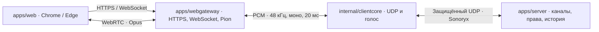

# Веб-доступ Sonoryx

Шлюз обслуживает браузерный интерфейс, HTTPS API, WebSocket и WebRTC отдельным процессом. Для каждой активной веб-сессии он подключается к одному настроенному серверу Sonoryx через обычный защищённый UDP. Поддерживаемые браузеры первой версии — Chrome и Edge на компьютере.



## Сборка и запуск

Версии `webgateway` и `web` задаются отдельно в [version/version.json](../../version/version.json). Шлюз печатает свою версию по `-version`, а сборка Vite помещает версию клиента в метатег `sonoryx-web-version` внутри `index.html`.

Для сборки Linux amd64 с Windows нужны Go из `go.mod`, Node.js, Zig и `tar` в `PATH`. Команды выполняются из корня репозитория.

```powershell
npm run build:webgateway
npm run deploy:webgateway
```

Сборка создаёт `bin/sonoryx-webgateway-linux-amd64.tar.gz` со шлюзом и статикой. Деплой по умолчанию использует тот же SSH-хост, что и `deploy-server.ps1`, и перезапускает сервис `sonoryx-webgateway.service`. Бинарник и статика переключаются вместе. Если сервис не подтвердит готовность, скрипт возвращает предыдущий релиз. Конфигурация, сертификаты и `stateDir` находятся за пределами каталога релиза.

Для отдельных обновлений `npm run build:gateway` собирает `bin/sonoryx-webgateway`, а `npm run build:web` собирает `apps/web/dist`. После первого полного веб-деплоя `npm run deploy:gateway` использует загруженный бинарник с текущей статикой, а `npm run deploy:web` — текущий бинарник с загруженной статикой. Оба варианта перезапускают веб-шлюз. Команды `npm run build-all` и `npm run deploy-all` охватывают сервер, шлюз и веб-клиент. `deploy-all` проверяет наличие обоих артефактов и разворачивает сервер и веб-релиз последовательно. Каждый сервис откатывается своим сценарием.

Перед первым деплоем создайте на хосте `/opt/sonoryx/webgateway` с правом записи для `admin`, разместите там `webgateway.json` и сертификаты. Возьмите за основу `configs/webgateway.example.json` и укажите:

- `server: "127.0.0.1:9000"` и `serverKey` действующего сервера Sonoryx.
- `webRoot: "current/web"` и постоянный `stateDir`, например `data`.
- `listen` и `origin` для вашего HTTPS-адреса. Для прямого доступа можно использовать `0.0.0.0:8443` и `https://ваш-домен:8443`. При HTTPS-прокси укажите публичный `origin` и сохраните исходный заголовок `Host`.
- `tlsCertificate` и `tlsKey` для HTTPS, `mediaFingerprint` для демонстрации экрана. При заданном `serverPasswordEnv` укажите значение пароля в защищённом `webgateway.env` для systemd.

Установите [пример systemd-сервиса](../../scripts/sonoryx-webgateway.service) на хосте. При использовании другого каталога или пользователя согласуйте пути и `User` в unit-файле с параметрами деплоя. SSH-пользователю нужны права `sudo` для управления этим сервисом.

```sh
sudo install -m 0644 sonoryx-webgateway.service /etc/systemd/system/sonoryx-webgateway.service
sudo systemctl daemon-reload
sudo systemctl enable sonoryx-webgateway.service
```

Откройте HTTPS-порт и UDP-диапазон `icePortMin`–`icePortMax` для WebRTC, либо настройте соответствующий маршрут через прокси и TURN. Диагностика доступна через `journalctl -u sonoryx-webgateway.service`.

Для ручной сборки непосредственно на Linux нужны Go, C-компилятор и Node.js. Сборка статики отдельно от шлюза доступна командой `npm run build:web` и использует `apps/web/dist`.

```sh
npm run build:web
mkdir -p bin
CGO_ENABLED=1 go build -trimpath -ldflags="-w -s" -o bin/sonoryx-webgateway ./apps/webgateway
cp configs/webgateway.example.json configs/webgateway.json
```

Укажите в [конфигурации](../../configs/webgateway.example.json) точный браузерный `origin` и `listen`. Установите TLS-сертификат и ключ для этого имени. При использовании прокси сохраняйте внешний заголовок `Host` и подключайтесь к HTTPS-шлюзу. `webRoot` должен указывать на собранный `apps/web/dist`, а `stateDir` — на постоянный каталог, доступный только служебному пользователю шлюза. Положения относительных путей отсчитываются от рабочего каталога процесса.

- `server` — фиксированный IP и UDP-порт сервера Sonoryx. При пропуске порта используется `9000`.
- `serverKey` — публичный Ed25519-ключ голосового сервера в стандартном Base64. Возьмите его из записи для этого IP и порта в доверенном десктопном `voice-pins.json`. Сверьте SHA-256 отпечаток с журналом запуска сервера, где он выводится как `voice server identity fingerprint=SHA256:…`.
- `mediaFingerprint` — SHA-256 отпечаток публичного TLS-ключа медиасервера Sonoryx, записанный байтами через двоеточие. Возьмите его из строки `media signaling configured` в журнале сервера. Пустое поле отключает веб-демонстрацию. Для просмотра и публикации браузеру нужен ICE-маршрут до UDP-портов медиасервера.
- `serverPasswordEnv` — имя переменной окружения с паролем Sonoryx, если он требуется. Пустое значение означает подключение без серверного пароля. Оператор задаёт пароль при запуске шлюза из окружения процесса.
- `loginMode` определяет форму входа. В примере задан `nickname`. Этот режим открывает вход по нику всем, кто может открыть веб-шлюз. Пароль подключения к Sonoryx при этом задаёт оператор шлюза. Конфигурации без `loginMode` используют режим `invite`.
- `icePortMin` и `icePortMax` задают UDP-диапазон прямого WebRTC на шлюзе. В примере это `21000–21100`. Откройте его на сетевом экране для прямой связи или настройте TURN. При двух нулях порт выбирается из системного диапазона.
- `iceServers` содержит обычные ICE-объекты, например STUN с полем `urls` и TURN с `urls`, `username` и `credential`. Шлюз передаёт их авторизованному браузеру, поэтому используйте отдельные TURN-реквизиты для веб-доступа.
- `sessionTTLSeconds` по умолчанию 3600. После разрыва WebSocket шлюз ждёт переподключения `reconnectGraceSeconds` (по умолчанию 30). При штатном закрытии WebSocket с кодом `1001` шлюз ждёт до 3 секунд, чтобы сохранить сессию при быстрой перезагрузке страницы. `maxSessions` по умолчанию 20 на процесс.

Пример для собственного STUN/TURN-сервиса. Подставьте его адрес и выделенные реквизиты.

```json
{
  "iceServers": [
    { "urls": ["stun:turn.example.org:3478"] },
    {
      "urls": ["turns:turn.example.org:5349?transport=tcp"],
      "username": "sonoryx-web",
      "credential": "REPLACE_WITH_TURN_PASSWORD"
    }
  ]
}
```

Для входа по нику достаточно запустить шлюз.

```sh
./bin/sonoryx-webgateway -config configs/webgateway.json
```

Шлюз создаёт отдельный Ed25519-ключ для профиля браузера и сохраняет его в `stateDir/browsers/`. Cookie идентичности действует до года и сохраняется при выходе из веб-сессии. Очистка cookie или вход из другого профиля создаёт новую идентичность. При переносе шлюза сохраните каталог `browsers/` и прежний HTTPS-адрес.

Для режима `invite` заранее создайте доступ командой `./bin/sonoryx-webgateway -config configs/webgateway.json -add-account alice -name "Алиса"`. Она один раз печатает код доступа. Список аккаунтов и их Ed25519-ключи хранятся в `stateDir/accounts/`. Для отзыва доступа вынесите каталог аккаунта из `accounts/` и перезапустите шлюз.

Sonoryx принимает до 10 новых серверных аккаунтов в час с одной сети источника. Регистрация происходит при первом подключении с новым ключом. В режиме `nickname` шлюз ограничивает начальную выдачу новых браузерных идентичностей пятью и пополняет лимит на одну идентичность за шесть минут. Шлюз также ограничивает попытки веб-входа по адресу и глобально.

## Эксплуатация

Шлюз сохраняет настройки обработки голоса, звуков Sonoryx, поведения в статусе «Отошёл» и громкости участников в `*.settings.json` рядом с ключом идентичности в `stateDir`. В режиме `nickname` настройки привязаны к профилю браузера, в режиме `invite` — к аккаунту приглашения. Громкость участников привязана к ключу сервера и идентификаторам аккаунтов Sonoryx, поэтому сохраняется при переподключении участников. Выбор устройств, тема, размер текста и переключатель уведомлений хранятся в браузере.

Веб-выход, истечение сессии и остановка процесса закрывают WebRTC и UDP. После исчезновения вкладки шлюз ждёт переподключения в пределах настроенного интервала. Новое согласование WebRTC закрывает предыдущий peer этого же аккаунта и использует текущую сессию `clientcore`.

Веб-интерфейс использует права Sonoryx для личных сообщений, модерации, администрирования каналов и аккаунтов, аудита и управления файлами. Загрузка, скачивание и файловая админка требуют включённого файлового HTTPS Sonoryx. Для демонстрации отдельно включите медиасервер и укажите его отпечаток.

Раз в минуту шлюз пишет агрегированные метрики. В них есть активные сессии, отказы из-за некорректных данных входа, ошибки WebRTC, обнаруженные пропуски входящих RTP, средняя задержка очереди воспроизведения в шлюзе и доступные показатели RTT и потерь между шлюзом и Sonoryx. Задержка очереди измеряет только участок внутри шлюза.

Для отключения веб-доступа остановите процесс шлюза сигналом `SIGTERM` и уберите внешний маршрут к нему, если он настроен. Для повторного включения используйте прежний `stateDir`.

Контракты браузера опубликованы в [HTTP/OpenAPI](../../contracts/web/http.yaml) и [схеме WebSocket](../../contracts/web/events.schema.json).
